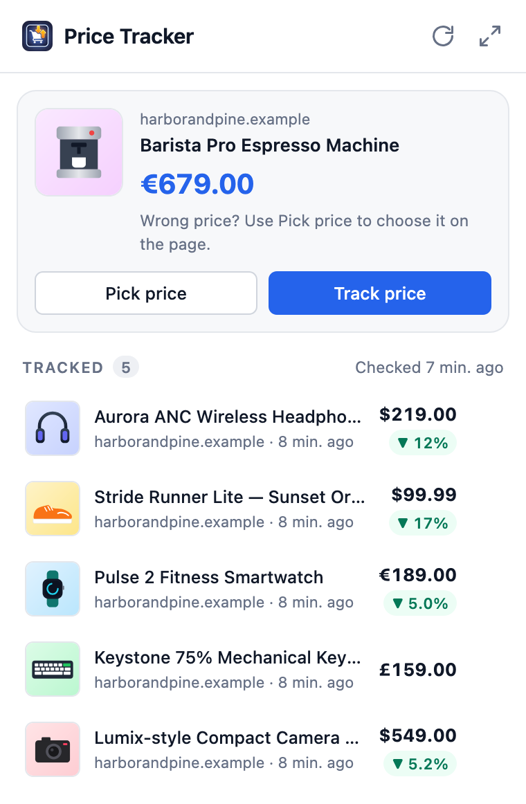
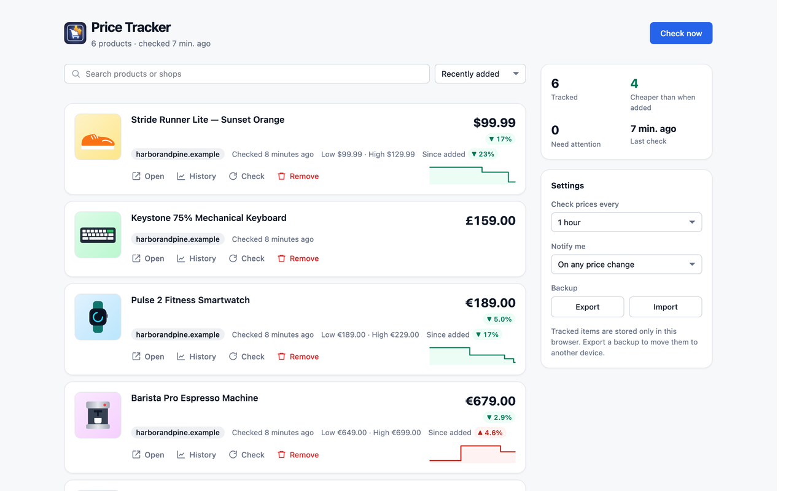
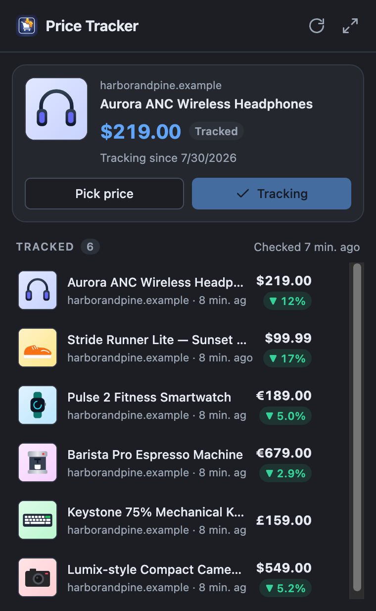
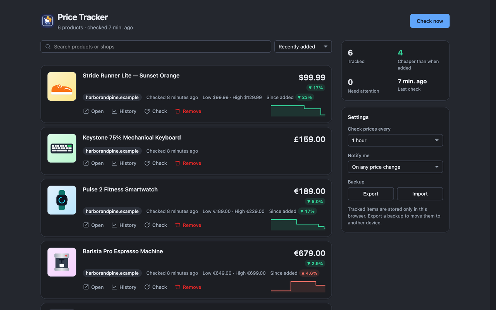
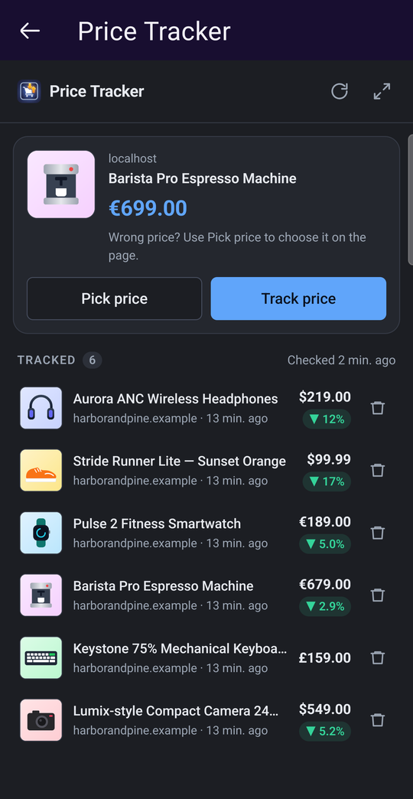
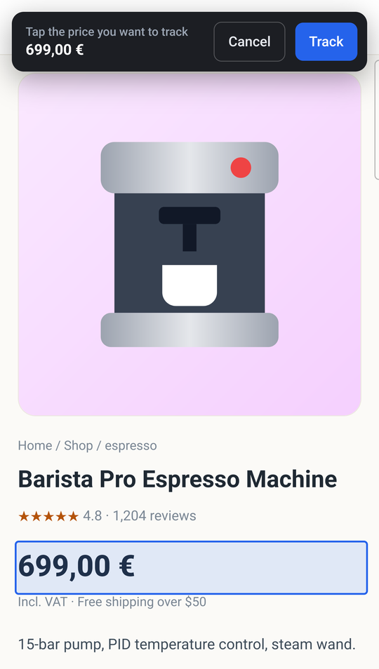
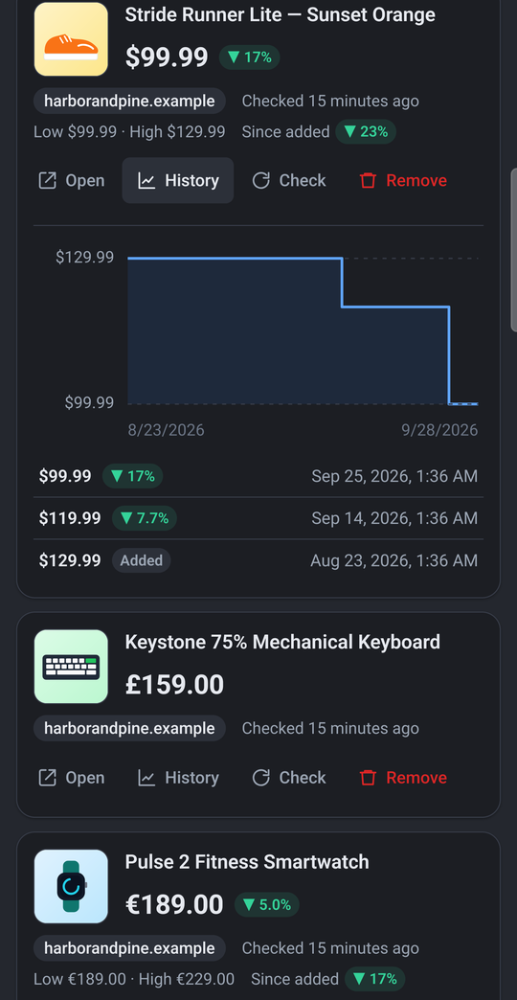

# Firefox Price Tracker

A Firefox WebExtension that lets you track product prices and notifies you
when they change. Runs on Firefox desktop and Firefox for Android.

**Published on AMO:**
https://addons.mozilla.org/en-US/firefox/addon/firefox-price-tracker/

## Features

- Click the toolbar icon on any product page — the price is detected with
  its currency and one click tracks it.
- Structured-data-first detection: JSON-LD `Product` and `ProductGroup`
  variants, microdata, OpenGraph / `product:price` meta tags (including
  time-boxed sale prices), WooCommerce, Magento, PrestaShop and Shopify
  markup, plus site rules for Amazon, Target, Newegg, MediaMarkt/Saturn,
  ASOS, ekupi.hr, Svijet medija and Emmezeta.
  Pages without a real product price are reported as such instead of
  false-positive matches on any `$…` text.
- Understands international price formats: `$1,299`, `1.299,00 €`,
  `12,99 zł`, `CHF 1'299.90`, `₹139` …
- Manual element picker with a live price preview: hover + click on
  desktop, tap + Confirm on Android.
- No false alarms from price glitches: a changed price is only recorded
  and notified once a second check a few minutes later confirms it.
- Works with JS-rendered product pages: the content script waits for the
  price to settle and updates the tracked item when you visit the page.
  The KW Automotive store's configurator and dm are checked in the
  background through the shops' own price APIs.
- Background checks every 15 minutes to 24 hours (default: hourly). Notify
  on every change or only on drops. Pages the background can't read are
  flagged with the reason.
- Dashboard with search, sorting, price-change badges, low/high, sparklines
  and a full price history chart per item.
- Export / import a JSON backup (storage is local to each browser).
- Runs on Firefox for Android (Fenix 142+) with the same code.
- No tracking, no analytics, no remote resources.

## Screenshots

| Popup | Dashboard |
|-------|-----------|
|  |  |
|  |  |

| Android: popup | Android: picker | Android: history |
|----------------|-----------------|------------------|
|  |  |  |

Store images (1280×800) for the AMO listing live in
[screenshots/amo/](screenshots/amo/). All screenshots use a fictional demo
shop.

## Installation

End users: install from the AMO link above.

## Development

Requirements: Node 20+ and a modern Firefox.

```bash
npm install
npm run typecheck   # tsc --noEmit
npm test            # unit tests (detection, urls, formatting, tracking logic)
npm run build       # bundle TypeScript → dist/
npm run lint        # web-ext lint dist/
npm start           # build + launch Firefox with the extension loaded
npm run package     # build + produce build/price_tracker-<version>.zip
```

`npm run build:watch` keeps esbuild running on file change — useful
alongside `npm start` when iterating, reloading the extension manually
from `about:debugging`.

For manual testing you can also open `about:debugging#/runtime/this-firefox`
and "Load Temporary Add-on" → pick `dist/manifest.json` after running
`npm run build`.

## Architecture

See [CLAUDE.md](CLAUDE.md) for a full tour. Short version:

```
manifest.json           Source-of-truth manifest (paths prefixed with dist/)
tsconfig.json           Strict TypeScript config (ES2022 + DOM)
build.mjs               esbuild bundler + static-asset copier
src/
  lib/
    price.ts            Price detection + parsing (structured data first)
    tracking.ts         History, price-change confirmation, import validation
    url.ts              Product identity + tracking-parameter cleanup
    format.ts           Currency formatting, titles, change %, times
    dom.ts              UI helpers: element builder, icons, charts
    types.ts            Storage + message types
  background.ts         Alarms, fetches, notifications (sole writer of storage)
  content_script.ts     In-page detection + manual-pick overlay
  popup.html + popup.ts Browser-action popup
  details.html + details.ts  Full-page dashboard
  styles.css            Single shared stylesheet
tests/                  Unit tests (node:test + happy-dom via tsx)
dist/                   Build output — gitignored, what actually ships
```

Storage format, message contract, and release instructions are all
documented in [CLAUDE.md](CLAUDE.md).

## License

MIT — see [LICENSE](LICENSE). Please keep the copyright notice when
redistributing and reference this repository so others can find the
original project.
